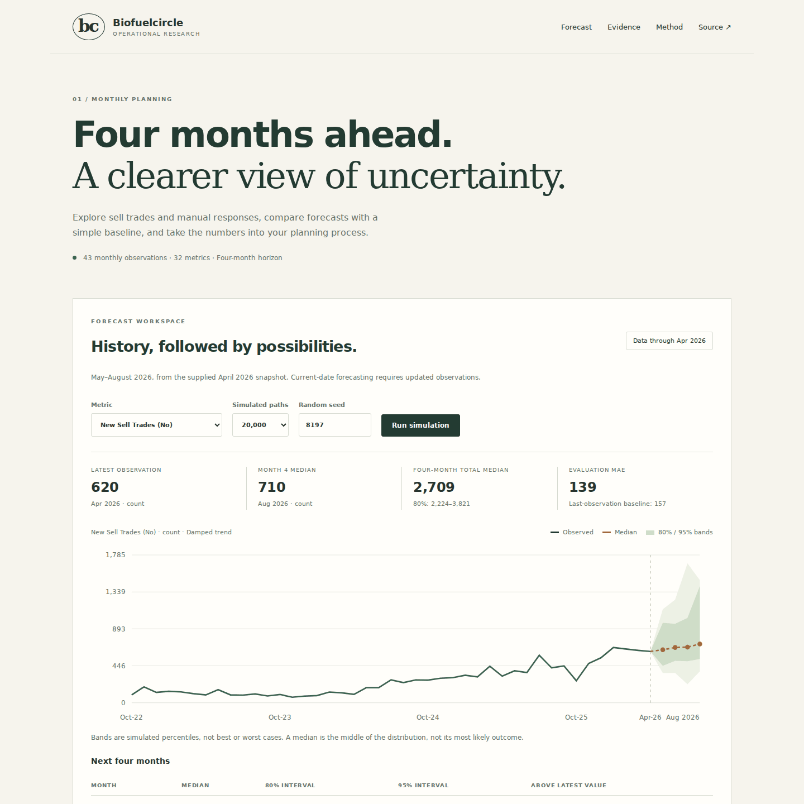
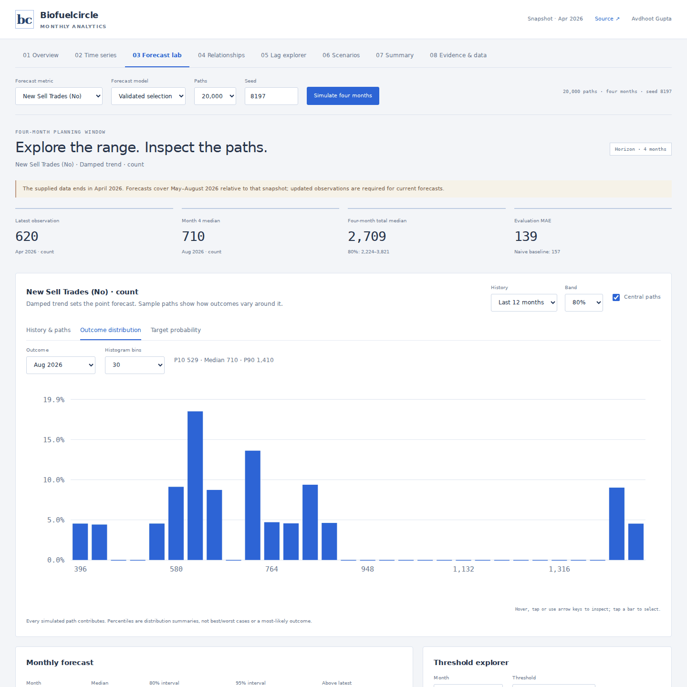

# Biofuelcircle · Four-month planning lab

Visit the model - https://modeldog8197.github.io/Biofuel-circle-monte-carlo/

Operational forecasting by **Avdhoot Gupta**, using the monthly platform workbook in this repository. The dashboard focuses on four measurable outputs: sell-trade counts and volumes, and manual-response counts and volumes.



## Interactive workspace · v2.1

The original analytical tools are restored in a compact tabbed workspace:

| Tool | Available interactions |
|---|---|
| Overview | Four sparklines, every source metric, monthly comparisons |
| Time series | Indexed, raw and monthly-change views; optional 3-month average; data CSV |
| Forecast lab | Recent-history window, six model comparisons, confidence bands, central trajectories |
| Outcome distribution | Choose any forecast month or the four-month total; inspect histogram bins |
| Target probability | Exact empirical exceedance curve; select a point to set the threshold |
| Relationships | Ranked associations, selectable scatter observations, 12- or 32-metric correlation matrix |
| Lag explorer | Lags 0–6, aligned observation dates, clickable heatmap and leading-association ranking |
| Scenarios | Driver inputs, explicit target-growth assumptions, persistence controls, three saved comparisons |
| Summary and evidence | Active model results, complete evaluation audit, provenance and limitations |

Line charts support hover/tap inspection, keyboard stepping, legend toggles, horizontal drag zoom and reset. The forecast opens with twelve historical months plus four future months instead of compressing the projection beside the entire history. A constant recent-mean forecast remains constant: sample trajectories show simulated variation without adding an artificial trend.

**Central paths** are distinct trajectories whose four monthly values lie inside their respective 80% bands. This is a labelled visual subset. All paths, including tails, contribute to distributions, probabilities, totals and exported data. Forecast SVGs and full paths can be downloaded.



### What-if assumptions

Driver scenarios use a descriptive ridge regression of monthly changes in platform-delivered volume, seller-delivered volume and open interest against each target's monthly changes. The fit uses only the development period, standardized predictor changes and ridge penalty 10. A supplied driver percentage is converted to an illustrative target offset using the latest observed driver level and fitted coefficient. The offset can persist across the four months or apply only in month one.

An independent, explicitly assumed target growth rate compounds month by month. Outcomes are clipped at zero and counts rounded. Scenario results are **conditional illustrations**, not validated causal intervention effects or new calibrated forecasts. The active temporal model's accuracy does not validate this driver-response mapping. Zero changes reproduce the baseline exactly. Saved comparisons retain the executed model, seed and assumptions and last only for the current session.

## What the project does

- Produces exactly **four months** of forecasts, with median, mean, 80% and 95% simulated intervals.
- Selects among six simple forecasting models using chronological development errors, then reports performance on later months against a last-observation baseline.
- Resamples complete four-month error vectors, retaining dependence across horizons within each target. Seeded simulations run in a browser worker.
- Reports monthly threshold probabilities and expected excess, and calculates four-month total percentiles from path sums.
- Exports all four targets to CSV and a reproducible JSON report with source history, error vectors, selection evidence and every evaluation prediction.
- Makes missing auxiliary values, signed observations, weak results and uncertainty coverage visible.

## Data and freshness

`Platform BU data for analysis.xlsx`, sheet `Trends data`, contains **43 monthly observations, October 2022–April 2026**, for 32 metrics. The workbook is preserved. Its cells are compared with `verified_data.json` by an automated test; targets are complete and auxiliary gaps remain null.

The included forecast is **May–August 2026, relative to the April 2026 snapshot**. It is not a current-date forecast. Regenerating with new observations advances the four-month window automatically. Volume units retain the original project's MT label and require confirmation from the source owner.

## Evaluation, including the weak results

Selection uses data through August 2025. The September 2025–April 2026 evaluation uses five expanding four-month origins: 20 overlapping target–horizon outcomes per metric. At each origin, models and uncertainty estimates use only earlier observations. Those 20 outcomes are **not 20 independent samples**.

| Target | Selected model | Evaluation MAE | Last-observation MAE | 80% interval coverage |
|---|---|---:|---:|---:|
| Sell-trade count | Damped trend | 138.9 | 157.2 | 70% |
| Sell-trade volume | Recent mean | 243,182.9 | 250,182.4 | 20% |
| Manual-response count | Recent mean | 268.1 | 204.5 | 70% |
| Manual-response volume | Recent mean | 70,794.0 | 94,048.8 | 40% |

Three targets improve on the simple baseline in this evaluation; manual-response counts do not. Coverage is below the nominal 80%, substantially so for volumes. These simulated probabilities are exploratory model outputs, **not calibrated planning guarantees**. More simulation paths reduce numerical sampling noise, not model error.

## Run locally

The dashboard has no build step or runtime JavaScript dependencies:

```sh
python -m http.server 4173
```

Open `http://localhost:4173`. Opening the HTML as a local file cannot load its JSON or module worker.

To check the workbook and regenerate outputs:

```sh
python -m venv .venv
# Activate the environment using the command for your operating system.
pip install -r requirements.txt
python 01_data_inspection.py
python forecast.py --paths 20000 --seed 8197
```

`02_full_analysis.py` remains a compatibility entry point. `forecast_report.json` and `forecast_report.csv` are generated outputs; browser controls regenerate paths for the selected target only. CSV rows identify their individual seed and path count when exported from the browser.

## Test

```sh
python -m unittest discover -s tests -p 'test_*.py' -v
npm ci
npm test
npx playwright install chromium
npm run test:e2e
```

Tests cover workbook equivalence, missing values, calendar gaps, four-month boundaries, constant/zero series, nonnegative integer counts, path totals, seeded Python/browser parity, model-selection isolation from later outcomes, causal intervals, responsive interaction, zoom and legend toggles, heatmap selection, scenario identity and persistence, lag alignment, histogram conservation and export reproducibility. GitHub Actions runs the complete suite.

## Method

Candidates are last observation, seasonal naive, six-month recent mean, damped 12-month trend, damped recent median drift and an adaptive inverse-error blend. The blend's weights use only already-observed four-month outcomes. The winning candidate minimizes development MAE; each model uses at least 18 months of history.

Historical forecast-error vectors are normalized by the level at their own origin. Final paths resample those vectors, center each horizon at its empirical error median, scale by the latest level, clip at zero and round counts. This empirical construction is deliberately simple: the short, changing history does not support a claim of reliable tail probabilities. Forecast MAE evaluates the deterministic point estimate, while displayed percentiles describe simulated paths.

Four-month totals sum each path **before** taking percentiles. No cross-target total is computed because dependence between targets is not modelled. Exploratory Pearson correlations use first differences and missing-pair exclusion; they establish neither causation nor forecasting skill.

The design follows [chronological forecast evaluation](https://otexts.com/fpp3/tscv.html) and [prediction-interval principles](https://otexts.robjhyndman.com/fpp3/prediction-intervals.html). Earlier generated annual forecasts and in-sample feature plots were removed from the active project; they remain in Git history.

## Structure

| File | Responsibility |
|---|---|
| `01_data_inspection.py` | Workbook extraction and validation |
| `forecast.py` | Selection, evaluation, simulation and report generation |
| `model.js`, `worker.js` | Reproducible browser simulation and scenario worker |
| `analysis.js` | Historical transforms, paired relationships, distributions and scenario arithmetic |
| `charts.js` | Interactive native SVG charts and selectable heatmaps |
| `app.js`, `index.html`, `styles.css` | Analytical dashboard |
| `tests/` | Model, accounting, parity and browser checks |

## Next evidence to collect

Obtain current data and confirm units; compare intervals over additional future origins; investigate regime changes and missing auxiliary definitions; test any proposed driver model against the same chronological baseline. Keep the later period out of model selection and retain negative findings.
